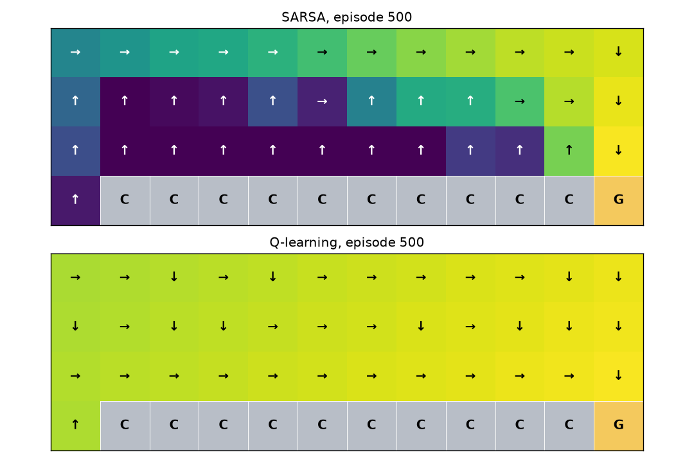
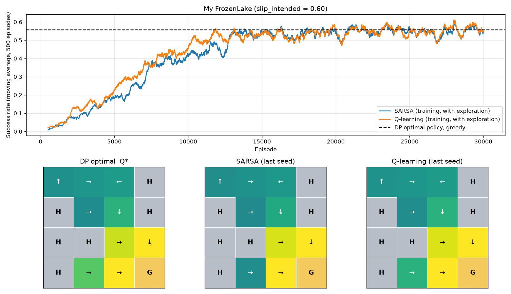

# SARSA & Q-Learning homework

**Student:** Mariam Ghazaryan  
**Student ID:** 7

## D1. When does the greedy route first reach the goal?

With training seed 0 and the provided 500-episode CliffWalking settings, SARSA first has a successful deterministic greedy route after episode **38**, and Q-learning after episode **15**. These are measured after every episode by `cliff_diagnostics.py`; the GIF only records every fifth episode. A first successful route need not remain successful in every subsequent episode. After episode 500 the SARSA route has **17 steps** and the Q-learning route **13 steps**.

Q-learning bootstraps from the maximum next-action value, so exploratory mistakes do not enter its target as the next action. SARSA bootstraps from the actual epsilon-greedy next action, and its values reflect changing exploration risk. This explains the earlier stabilisation of Q-learning's map.



## D2. Values immediately above the cliff

SARSA accounts for exploratory moves into the cliff and their -100 reward. At state 25, for example, its final maximum Q is approximately **-203.68**, compared with **-10.47** for Q-learning. The GIF's fixed [-100, 0] scale clips these strongly negative values visually; it does not alter the Q-table. Q-learning's target assumes greedy future actions, which can follow the cliff edge safely in this deterministic environment. If SARSA's epsilon approached zero and learning continued sufficiently, its target would approach greedy control and its route would tend toward the shorter cliff-edge optimum. Previously learned values would not change instantly.

## D3. Action numbering and arrows

The plot receives an explicit action-to-arrow dictionary: CliffWalking uses `0: up, 1: right, 2: down, 3: left`, while FrozenLake uses `0: left, 1: down, 2: right, 3: up`. Each arrow is selected from the dictionary using `argmax(Q[state])`. The supplied self-check verifies that CliffWalking action 1 produces right arrows in all 37 ordinary cells.

## D4. Termination versus truncation

Reaching a hole or the goal ends the MDP task, so the TD target is just **r**. A 100-step time limit ends collection of this episode, while the underlying nonterminal state still has future value. The truncated SARSA target is **r + gamma Q(s', a')**, and the truncated Q-learning target is **r + gamma max_a Q(s', a)**. Treating truncation as termination replaces those targets with r, discards future value and biases learned values downward. This assignment evaluates discounted continuing-until-terminal values with DP, and reports 100-step success separately.

## D5. Hyperparameters and measured comparison

The generated map is:

```text
SFFH
HFFH
HHFF
HFFG
```

The intended direction has probability 0.60; each perpendicular direction has probability 0.20. The exact discounted optimal start value is **0.4841** (rounded).

| Policy | Mean value ratio | Worst seed | Mean 100-step success | Time (s) |
|---|---:|---:|---:|---:|
| DP optimal | 1.000 | — | 0.556 | — |
| SARSA, lab settings | 0.564 | 0.511 | 0.294 | 0.2 |
| Q-learning, lab settings | 0.555 | 0.450 | 0.293 | 0.2 |
| SARSA, tuned settings | 1.000 | 1.000 | 0.556 | 9.9 |
| Q-learning, tuned settings | 1.000 | 1.000 | 0.556 | 10.8 |

These are the provided runner's measurements for training seeds 0, 1 and 2, using 2,000 greedy evaluation episodes per seed. Runtime includes evaluation and depends on the computer. Success evaluations reuse the same evaluation seeds, so identical policies have identical success estimates.

The tuned parameters are **30,000 episodes, alpha 0.02, epsilon decay 0.9997, epsilon floor 0.01, gamma 0.99**. Sparse goal rewards, early termination in holes and stochastic transitions leave 500 episodes insufficient. At episode 500 the original epsilon is only about 0.082, whereas the tuned epsilon is about 0.861; slower decay preserves early exploration. The tuned schedule reaches its 0.01 floor around episode 15,349, leaving many nearly greedy episodes for refinement. The smaller alpha reduces noise from individual slip outcomes. More episodes provide repeated coverage and propagation of the rare positive rewards.

To identify which change helped most, `tuning_experiments.py` changes one parameter at a time from the lab baseline and averages the exact value ratios over seeds 0–2:

| Change from lab baseline | SARSA mean ratio | Q-learning mean ratio |
|---|---:|---:|
| None | 0.564 | 0.555 |
| 30,000 episodes only | 1.000 | 0.847 |
| Decay 0.9997 only | 0.483 | 0.741 |
| Alpha 0.02 only | 0.544 | 0.541 |
| All three changes | 1.000 | 1.000 |

**More episodes helped most as an isolated change** for both agents. Slower decay alone helps Q-learning, but does not help SARSA when training still stops after only 500 highly exploratory episodes. Lower alpha alone also needs more training to propagate reward. The combined settings satisfy the requirement for both agents. Ratios can exceed 1 by about 9e-10 because value iteration uses a finite convergence tolerance; this is numerical error, not a better-than-optimal policy.



## D6. Success probability and discounted value

Yes. Success within 100 steps and discounted expected return are different objectives. A policy may have more successful but slower trajectories and thus a lower expected discounted return. For example, reaching the goal with probability 0.80 after 10 actions gives approximately `0.80 * 0.99**9 = 0.731`, whereas probability 0.90 after 90 actions gives `0.90 * 0.99**89 = 0.368`. Finite-sample success estimates also contain sampling noise. DP here optimises discounted value without the 100-step cutoff.

## D7. Differences from the DP policy

For the displayed final training seed (**2**), both learned greedy policies match the DP action in **every S/F state**: the difference lists printed by Part C are both empty. Thus there are no differing states to explain for this run. All three seeds also attain value ratio 1.000 to the runner's displayed precision; an optimal start value alone would not generally prove equality of every action, so the statewise statement is based on the explicit comparison for the last seed.

## D8. Why the routes differ on CliffWalking but are similar on FrozenLake

In deterministic CliffWalking, Q-learning's greedy target ignores exploratory cliff falls and prefers the short edge route; SARSA evaluates the exploratory policy and favours a safer route. FrozenLake's slip risk is part of the environment transition probabilities, so both algorithms must learn it, including Q-learning. With epsilon decaying to 0.01, SARSA's behaviour is nearly greedy and both methods can approach the same discounted optimum, although finite data and near-tied actions can leave differences.
